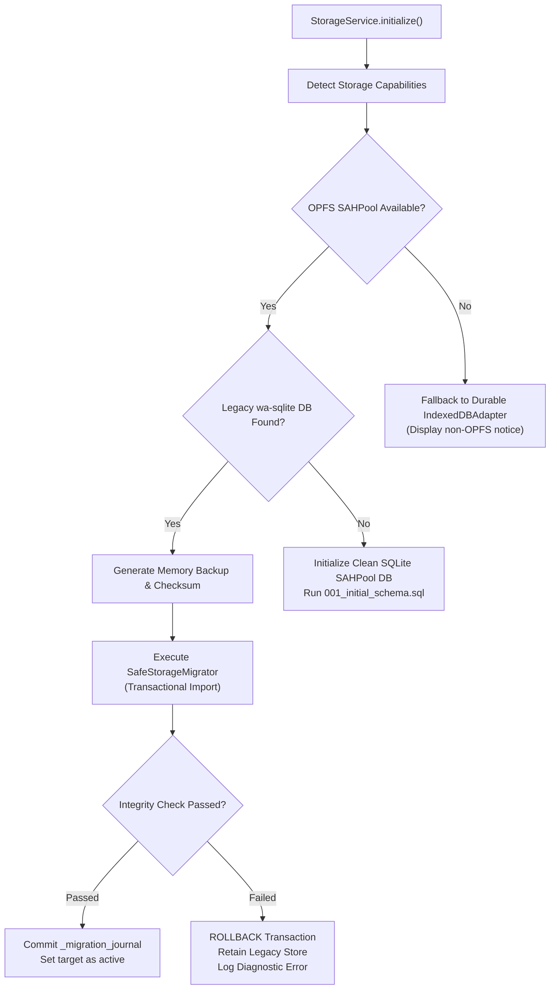
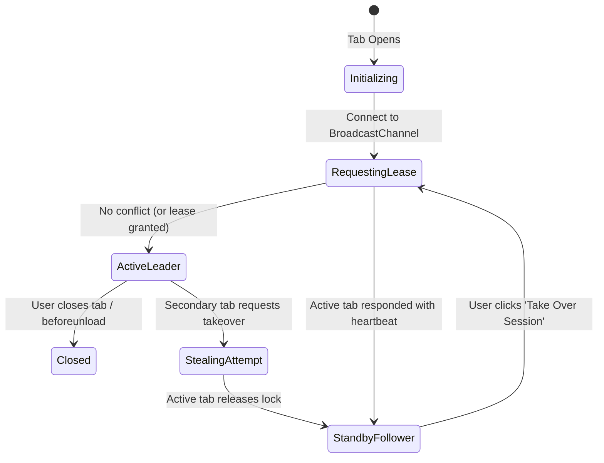

# Storage Migration & Tab-Coordination Design Specification

> **Document Type:** Technical Design & Protocol Specification  
> **Task ID:** P0.3  
> **Status:** Approved for Implementation (Gate 0 Artifact)  
> **Target Scope:** SQLite WASM migration, OPFS SAHPool lease protocol, durable fallback, and crash-recovery procedures  

---

## 1. Overview & Architectural Principles

ERD Forge maintains a dual-layer storage model:
1. **Portable Source of Truth:** `.erdforge` JSON project files (serializable, portable, user-owned).
2. **Local Metadata Catalog:** Client-side SQLite database used for rapid querying, cross-schema search, and lineage inspection.

This specification details the transition from legacy `wa-sqlite` (`IDBBatchAtomicVFS` on IndexedDB) to consortium-standard `@sqlite.org/sqlite-wasm` (`opfs-sahpool` on the Origin Private File System).

### Non-Negotiable Guarantees
* **Zero Silent Data Loss:** The application will never silently downgrade to a volatile in-memory database. If OPFS is unavailable, the system seamlessly uses durable IndexedDB.
* **Idempotency & Rollback Safety:** Migrations must be safely interruptible at any millisecond. The legacy store is never altered or deleted during migration.
* **Single-Tab Exclusivity:** `opfs-sahpool` requires exclusive access to the SAH pool. Cross-tab write conflicts are prevented via a deterministic lease protocol.

---

## 2. Source-Store Detection & Pre-Flight Snapshot



### Pre-Flight Snapshot Format
Before modifying or initializing target storage, `StorageService` dumps legacy catalog records into an in-memory snapshot:

```typescript
export interface StorageSnapshot {
  schemaVersion: number;
  timestamp: string;
  sourceEngine: 'wa-sqlite-v1';
  checksum: string;
  tables: {
    projects: any[];
    entities: any[];
    columns: any[];
    relationships: any[];
    metadata: any[];
  };
}
```

---

## 3. SafeStorageMigrator Protocol (Idempotent & Transactional)

### Database Journal Schema
The target SQLite database initializes a migration journal table before any data insertion:

```sql
CREATE TABLE IF NOT EXISTS _migration_journal (
  id              INTEGER PRIMARY KEY AUTOINCREMENT,
  source_engine   TEXT NOT NULL,
  source_checksum TEXT NOT NULL,
  records_migrated INTEGER NOT NULL,
  status          TEXT NOT NULL CHECK(status IN ('in_progress', 'verified', 'failed')),
  applied_at      DATETIME DEFAULT CURRENT_TIMESTAMP
);
```

### 5-Step Transactional Execution Sequence
1. **Begin Transaction:** Execute `BEGIN IMMEDIATE TRANSACTION;` on the target SQLite connection.
2. **Record Intent:** Insert a row into `_migration_journal` with `status = 'in_progress'`.
3. **Chunked Insertion:** Stream snapshot records into target tables (`projects`, `entities`, etc.) using parameterized batch inserts.
4. **Automated Verification:**
   * Verify row counts: `SELECT COUNT(*) FROM entities` must exactly equal `snapshot.tables.entities.length`.
   * Verify foreign key integrity: Execute `PRAGMA foreign_key_check;`.
   * Verify database integrity: Execute `PRAGMA integrity_check;`.
5. **Commit & Journal Finalization:**
   * Update `_migration_journal` status to `'verified'`.
   * Execute `COMMIT;`.
   * Retain the legacy IndexedDB database intact as a dormant backup.

### Recovery from Interruption or Failure
* **Browser Closed Mid-Migration:** Upon restart, SQLite's transactional rollback guarantees that partial writes are rolled back. `_migration_journal` will not have a `'verified'` entry, triggering a clean re-migration.
* **Storage Quota Exceeded:** Caught by `catch (err)`. Executes `ROLLBACK;`, unbinds target, displays *"Storage quota exceeded. Free disk space or reduce project size."*, and activates read-only access to legacy storage.

---

## 4. Single-Tab Lease Protocol (`erd-forge-storage-lock`)

The `opfs-sahpool` VFS takes an exclusive file lock on the underlying storage directory. If multiple browser tabs attempt concurrent read/write operations, unhandled pool acquisition exceptions occur.

### Tab State Machine



### Protocol Specification
* **Channel Name:** `BroadcastChannel('erd-forge-storage-lock')`
* **Heartbeat Frequency:** Every 2,000 ms by the `ActiveLeader`.
* **Heartbeat Timeout:** If no heartbeat is received within 5,000 ms, the active lease is considered stale and automatically claimable.
* **Message Payloads:**
  ```typescript
  type StorageLockMessage =
    | { type: 'WHO_IS_LEADER'; tabId: string }
    | { type: 'LEADER_HEARTBEAT'; tabId: string; lastActive: number }
    | { type: 'REQUEST_TAKEOVER'; requestingTabId: string }
    | { type: 'RELEASE_LEASE'; tabId: string }
    | { type: 'LEASE_GRANTED'; toTabId: string };
  ```

### User-Facing Conflict Experience
When a user opens ERD Forge in Tab B while Tab A is active:
1. Tab B detects the active lease within 300 ms.
2. Tab B displays a non-destructive blocking modal:
   > **ERD Forge is open in another tab**  
   > To protect your local database catalog from write conflicts, ERD Forge operates in one active tab at a time.  
   >  
   > `[ Switch to This Tab ]` `[ Open in Read-Only Mode ]`
3. If the user clicks **Switch to This Tab**:
   * Tab B sends `{ type: 'REQUEST_TAKEOVER', requestingTabId: tabB }`.
   * Tab A receives the request, cleanly flushes unwritten buffers, closes the SQLite database handle via `adapter.close()`, and transitions to `StandbyFollower`.
   * Tab B acquires the SAHPool handle and opens the database.

---

## 5. Web Worker Boundary Architecture

Synchronous SQLite C calls (`db.exec()`, `db.prepare()`) must never run on the UI thread. The worker architecture is structured as follows:

```
┌──────────────────────────────────────────────┐
│ Main UI Thread                               │
│  - StorageService                            │
│  - OPFSSQLiteAdapter (Proxy Client)          │
│  - Tab Lease Manager (BroadcastChannel)      │
└───────────────────────▲──────────────────────┘
                        │ Comlink (postMessage)
┌───────────────────────▼──────────────────────┐
│ apps/web/src/workers/sqlite.worker.ts        │
│  - @sqlite.org/sqlite-wasm engine            │
│  - installOpfsSAHPoolVfs({})                 │
│  - Synchronous db.exec() & statement loops   │
│  - OPFS SAH Pool storage files               │
└──────────────────────────────────────────────┘
```

---

## 6. Durable Fallback Hierarchy

To ensure the **Zero Silent Data Loss** guarantee:

1. **Tier 1 (Preferred):** `@sqlite.org/sqlite-wasm` via `opfs-sahpool` in Web Worker. (Zero extra headers, native disk persistence).
2. **Tier 2 (Durable Fallback):** `IndexedDBAdapter` in Main Thread / Worker. (Used when OPFS is blocked by browser policies, private browsing windows, or unsupported WebAssembly file system APIs).
3. **Forbidden Fallback:** In-memory `new oo1.DB('catalog.db', 'ct')` is **strictly disallowed** for user catalogs. If both OPFS and IndexedDB fail, the application displays a fatal initialization error and prevents catalog write actions until resolved.

---

## 7. Rollback Decision Tree

| Failure Mode | Immediate System Action | User Impact | Rollback Path |
|:---|:---|:---|:---|
| **SAHPool VFS initialization throws error** | Fallback to `IndexedDBAdapter` | Catalog operates in IndexedDB mode | None required; automatic fallback |
| **Integrity check mismatch after migration** | Execute `ROLLBACK;` in SQLite | Database initialization pauses; notification shown | Legacy IndexedDB remains active; error logged to diagnostics |
| **Worker fails to initialize in production** | Fallback to main-thread IndexedDB | App functions normally without OPFS | Revert feature flag `VITE_STORAGE_ENGINE=wa-sqlite` |
| **Stale lock / Tab unresponsive** | User clicks "Force Takeover" in UI | Secondary tab forcibly acquires lease | Stale tab is notified and closed |
