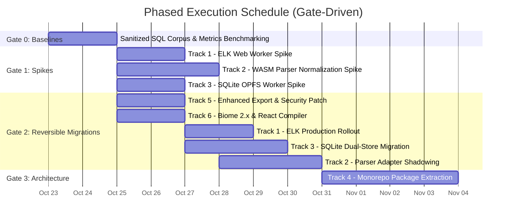
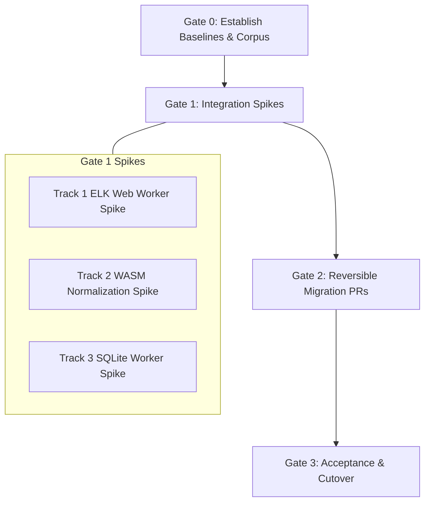

# ERD Forge — Tech Stack Upgrade Plan (Next Phase)

> **Document Type:** Architecture & Implementation Plan  
> **Status:** Validation Required — Discovery Spikes Authorized  
> **Created:** 2026-10-13  
> **Last Validated:** 2026-10-22 — Comprehensive architectural hardening pass incorporating independent validation review and codebase cross-checks  
> **Scope:** Infrastructure, dependencies, and architecture modernization for enterprise scale and long-term production resilience  
> **Affects:** Graph layout engine, multi-dialect SQL parser, storage layer, export pipeline, monorepo architecture, and developer tooling  

---

## Change Log

### Validation Pass 2 (Comprehensive Hardening — 2026-10-22)

| # | Track | Category | Issue Identified in Review | Resolution Applied |
|:--|:------|:---------|:---------------------------|:-------------------|
| 1 | Global | Governance | Premature "Approved / Ready for Execution" status with unvalidated spikes | Changed status to **Validation Required — Discovery Spikes Authorized**; structured execution around **Gates 0–3**. |
| 2 | Track 2 | Dependency | Typo (`@guanmingchieu`) in Vite config; invalid semver `"^latest"` | Corrected to `@guanmingchiu/sqlparser-ts`; pinned to published release `^0.1.0`; documented Apache 2.0 license and bundle budget. |
| 3 | Track 2 | Semantics | `normalize(/* ... */)` was an empty placeholder; `dialect as any` bypassed typing | Defined typed `mapToWasmDialect()` mapper and comprehensive `NormalizedStatement` AST contract covering CTEs, joins, qualify, and set ops; set parity spike as decision gate. |
| 4 | Track 3 | Storage Durability | Fallback to volatile in-memory SQLite silently discarded user data on reload | Replaced in-memory fallback with fallback to existing durable `IndexedDBAdapter`; added user-visible non-persistence warning if both fail. |
| 5 | Track 3 | Thread Safety | Synchronous `db.exec()` executed directly on UI thread | SQLite / OPFS operations moved behind a dedicated Web Worker boundary using Comlink. |
| 6 | Track 3 | Concurrency | `opfs-sahpool` single-tab limitation unaddressed | Added BroadcastChannel tab-lock coordination (`erd-forge-storage-lock`) with active tab detection, lock indicator, and graceful tab takeover. |
| 7 | Track 3 | Migration Safety | `localStorage` boolean flag was non-transactional and prone to crash-inconsistency | Designed versioned, idempotent migration with row count and checksum verification, retaining legacy store until verification passes. |
| 8 | Track 1 | Layout Hierarchy | Flat graph failed to deliver promised compound domain/sheet groupings | Defined nested `ElkNode` structure for compound groups with group-level padding and hierarchy. |
| 9 | Track 1 | Layout Reliability | `table.name` node ID collided across schemas; unlinked nodes stacked at `{ x: 80, y: 80 }` | Switched to qualified IDs (`${schema}.${table}`); implemented deterministic multi-column grid placement for unlinked nodes. |
| 10 | Track 1 | Concurrency | Async layout lacked cancellation or stale-result protection | Added layout generation counter (`layoutEpoch`) to discard out-of-order layout resolutions. |
| 11 | Track 5 | Export Robustness | `String.fromCharCode(...uint8)` triggered stack overflow on large fonts | Replaced with chunked base64 conversion (32KB blocks) preventing argument limit violations. |
| 12 | Track 5 | Export Security | CSV export vulnerable to formula injection (`=`, `+`, `-`, `@`) | Added OWASP CSV injection neutralization prefix (`'`) on sensitive cell beginnings. |
| 13 | Track 5 | Export Scope | Overstated vector fidelity in Figma for `<foreignObject>` SVGs | Explicitly scoped SVG export to browser viewing/printing; documented rasterization requirement for vector editors. |
| 14 | Track 6 | Tooling | Biome config used legacy schema conventions; performance claims unbenchmarked | Updated to Biome 2.x standard configuration (`assist.actions` structure); converted performance claims into measurable benchmark targets. |

---

## 1. Executive Summary & Strategy

ERD Forge's tech stack is well-architected for initial releases. However, scaling to **500+ table schemas**, **multi-dialect SQL lineage parsing**, and **headless CLI consumption** requires addressing fundamental architectural limitations:

* Main-thread layout execution stalls UI interactivity during auto-arrange.
* RegEx and AST approximations in `node-sql-parser` fail modern warehouse SQL constructs (`QUALIFY`, `PIVOT`, Snowflake `MATCH_RECOGNIZE`).
* Storage persistence relies on experimental IndexedDB hacks (`wa-sqlite`) rather than standardized browser file systems.
* DOM-dependent exports and monolith folder structures hinder reusability.

### Guiding Principles

1. **Discovery Spikes Precede Cutover:** No legacy library (`node-sql-parser`, `@dagrejs/dagre`, `wa-sqlite`) is removed until the replacement achieves measurable parity on a verified test corpus.
2. **Never Compromise Durability:** Under no circumstance may storage fallback silently degrade to volatile memory without explicit user confirmation.
3. **Keep Heavy Work Off the UI Thread:** Layout calculation and database disk I/O must execute inside dedicated Web Workers.

---

## 2. Upgrade Tracks Overview

| Track | Name | Priority | Risk | Effort | Target Outcome |
|:-----:|:-----|:--------:|:----:|:------:|:---------------|
| **1** | **Graph Layout Engine** (Dagre to ELK) | High | Medium | ~3 days | Off-thread Web Worker layout, compound nodes for domains/sheets, 500+ table scalability |
| **2** | **SQL Parser** (node-sql-parser to sqlparser-ts WASM) | High | High | ~5 days | First-class dialect support (BigQuery, Snowflake, Databricks, PostgreSQL, DuckDB) via adapter |
| **3** | **SQLite Storage** (wa-sqlite to @sqlite.org/sqlite-wasm) | Medium | High | ~3 days | OPFS SAHPool disk I/O without COOP/COEP constraints, durable IndexedDB fallback, tab locking |
| **4** | **Monorepo Package Extraction** | Medium | Medium | ~4 days | Headless core, parser, and lineage packages with zero DOM dependencies |
| **5** | **Canvas Export** (Enhanced html-to-image) | Low | Low | ~1 day | Offline font embedding, stack-safe base64 encoding, OWASP-safe CSV export |
| **6** | **Developer Tooling** (Biome 2.x + React Compiler) | Low | Low | ~1 day | Sub-second CI linting/formatting, automated component memoization for React 19 canvas nodes |



---

## 3. Detailed Track Specifications

---

### Track 1: Graph Layout Engine — Dagre to ELK

#### Problem Statement
`@dagrejs/dagre` (v3.1.1) is unmaintained, executes synchronously on the main thread, lacks support for compound nodes (grouping tables by domains or database schemas), and routes orthogonal edges poorly on dense diagrams.

ELK (`elkjs`) provides industrial-grade hierarchical layouts, compound hierarchy, and native Web Worker offloading.

#### Surface Area
* `apps/web/src/core/layout/autoLayout.ts` — ERD layout calculation (121 lines)
* `apps/web/src/lineage/layout/lineageLayout.ts` — Lineage layout calculation (91 lines)
* `apps/web/src/components/canvas/ERDCanvas.tsx` — Consumes layout positions
* `apps/web/tests/core/layout/autoLayout.test.ts` — Unit tests (140 lines)

#### Key Architectural Requirements
1. **Web Worker Offloading:** Must use `elkjs/lib/elk-api` with a worker factory pointing to `elk-worker.min.js`. Never import `elk.bundled.js` on the main thread.
2. **Compound Hierarchy:** Model domains/sheets as parent nodes with internal child tables so visual groups are laid out hierarchically without manual bounding-box recalculation.
3. **Collision-Free IDs:** Node IDs must be fully qualified (`${schema}.${tableName}`) to prevent collisions between identical table names across different schemas.
4. **Deterministic Unlinked Node Placement:** Tables without relationships must be placed in a clean multi-column grid offset below the main diagram, avoiding coordinate stacking at `{ x: 80, y: 80 }`.
5. **Race Condition Protection:** Every layout request must carry an incrementing `layoutEpoch` to ignore stale results if the user edits the schema while layout is computing.

#### Implementation

##### 1. Worker Setup (`apps/web/src/core/layout/elkInstance.ts`)
```typescript
import ELK from 'elkjs/lib/elk-api';

const elk = new ELK({
  workerFactory: () =>
    new Worker(new URL('elkjs/lib/elk-worker.min.js', import.meta.url), {
      type: 'module',
    }),
});

export default elk;
```

##### 2. Layout Engine (`apps/web/src/core/layout/autoLayout.ts`)
```typescript
import elk from './elkInstance';
import type { ElkNode, ElkExtendedEdge } from 'elkjs/lib/elk-api';

export interface LayoutTable {
  id?: string;
  name: string;
  schema?: string;
  domain?: string;
  columns?: any[];
  measuredWidth?: number;
  measuredHeight?: number;
}

export interface LayoutRef {
  sourceSchema?: string;
  sourceTable: string;
  targetSchema?: string;
  targetTable: string;
  direction?: string;
}

export interface LayoutOptions {
  direction?: 'LR' | 'TB';
  nodeWidth?: number;
  nodeSpacingY?: number;
  rankSpacing?: number;
}

export interface NodePosition {
  x: number;
  y: number;
}

export type LayoutMap = Map<string, NodePosition>;

export function estimateTableHeight(columnCount: number): number {
  const HEADER_HEIGHT = 44;
  const COLUMN_HEIGHT = 32;
  const FOOTER_PADDING = 16;
  return Math.max(100, HEADER_HEIGHT + columnCount * COLUMN_HEIGHT + FOOTER_PADDING);
}

function getNodeKey(schema?: string, table?: string): string {
  return `${schema || 'public'}.${table || ''}`;
}

export async function calculateAutoLayout(
  tables: LayoutTable[],
  refs: LayoutRef[],
  options: LayoutOptions = {},
  signal?: AbortSignal
): Promise<LayoutMap> {
  const {
    direction = 'LR',
    nodeWidth = 260,
    nodeSpacingY = 50,
    rankSpacing = 100,
  } = options;

  // Group tables by domain for compound layout
  const domainGroups = new Map<string, LayoutTable[]>();
  const unassignedTables: LayoutTable[] = [];

  tables.forEach((table) => {
    if (table.domain) {
      const group = domainGroups.get(table.domain) || [];
      group.push(table);
      domainGroups.set(table.domain, group);
    } else {
      unassignedTables.push(table);
    }
  });

  const children: ElkNode[] = [];

  // 1. Add domain compound nodes
  domainGroups.forEach((groupTables, domainName) => {
    children.push({
      id: `domain-${domainName}`,
      layoutOptions: {
        'elk.padding': '[top=40,left=30,bottom=30,right=30]',
        'elk.spacing.nodeNode': String(nodeSpacingY),
      },
      children: groupTables.map((table) => ({
        id: getNodeKey(table.schema, table.name),
        width: table.measuredWidth || nodeWidth,
        height: table.measuredHeight || estimateTableHeight(table.columns?.length ?? 0),
      })),
    });
  });

  // 2. Add root-level tables
  unassignedTables.forEach((table) => {
    children.push({
      id: getNodeKey(table.schema, table.name),
      width: table.measuredWidth || nodeWidth,
      height: table.measuredHeight || estimateTableHeight(table.columns?.length ?? 0),
    });
  });

  // 3. Map relationships with orthogonal edge routing
  const edges: ElkExtendedEdge[] = refs
    .filter((ref) => getNodeKey(ref.sourceSchema, ref.sourceTable) !== getNodeKey(ref.targetSchema, ref.targetTable))
    .map((ref, idx) => {
      const sourceKey = getNodeKey(ref.sourceSchema, ref.sourceTable);
      const targetKey = getNodeKey(ref.targetSchema, ref.targetTable);
      return {
        id: `edge-${idx}`,
        sources: [ref.direction === '<' ? sourceKey : targetKey],
        targets: [ref.direction === '<' ? targetKey : sourceKey],
      };
    });

  const elkGraph: ElkNode = {
    id: 'root',
    layoutOptions: {
      'elk.algorithm': 'layered',
      'elk.direction': direction === 'LR' ? 'RIGHT' : 'DOWN',
      'elk.edgeRouting': 'ORTHOGONAL',
      'elk.spacing.nodeNode': String(nodeSpacingY),
      'elk.layered.spacing.baseValue': String(rankSpacing),
      'elk.padding': '[top=80,left=80,bottom=80,right=80]',
    },
    children,
    edges,
  };

  if (signal?.aborted) throw new DOMException('Layout aborted', 'AbortError');

  const layout = await elk.layout(elkGraph);

  if (signal?.aborted) throw new DOMException('Layout aborted', 'AbortError');

  const positions: LayoutMap = new Map();
  let maxLayoutX = 80;
  let maxLayoutY = 80;

  const extractPositions = (nodes: ElkNode[] = [], parentX = 0, parentY = 0) => {
    nodes.forEach((node) => {
      const absoluteX = parentX + (node.x ?? 0);
      const absoluteY = parentY + (node.y ?? 0);

      if (node.children && node.children.length > 0) {
        extractPositions(node.children, absoluteX, absoluteY);
      } else {
        positions.set(node.id, {
          x: Math.round(absoluteX),
          y: Math.round(absoluteY),
        });
        maxLayoutX = Math.max(maxLayoutX, absoluteX + (node.width ?? nodeWidth));
        maxLayoutY = Math.max(maxLayoutY, absoluteY + (node.height ?? 100));
      }
    });
  };

  extractPositions(layout.children);

  // 4. Deterministic grid placement for unlinked / missing tables
  let gridCol = 0;
  let gridRow = 0;
  const GRID_COLS = 4;
  const GRID_START_Y = maxLayoutY + 120;

  tables.forEach((table) => {
    const key = getNodeKey(table.schema, table.name);
    if (!positions.has(key)) {
      const x = 80 + gridCol * (nodeWidth + 40);
      const y = GRID_START_Y + gridRow * 220;
      positions.set(key, { x, y });

      gridCol++;
      if (gridCol >= GRID_COLS) {
        gridCol = 0;
        gridRow++;
      }
    }
  });

  return positions;
}
```

##### 3. Caller Race-Condition Protection (`ERDCanvas.tsx`)
```typescript
import { useRef, useEffect } from 'react';
import { useNodesInitialized } from '@xyflow/react';

export function useAutoLayoutManager(tables: LayoutTable[], refs: LayoutRef[], direction: 'LR' | 'TB') {
  const nodesInitialized = useNodesInitialized();
  const currentEpochRef = useRef(0);
  const abortControllerRef = useRef<AbortController | null>(null);

  useEffect(() => {
    if (!nodesInitialized || tables.length === 0) return;

    // Cancel pending layout calculation
    if (abortControllerRef.current) {
      abortControllerRef.current.abort();
    }

    const abortController = new AbortController();
    abortControllerRef.current = abortController;
    const thisEpoch = ++currentEpochRef.current;

    calculateAutoLayout(tables, refs, { direction }, abortController.signal)
      .then((positions) => {
        // Discard if newer layout request was dispatched
        if (thisEpoch !== currentEpochRef.current) return;
        // Apply positions to Zustand store
      })
      .catch((err) => {
        if (err.name !== 'AbortError') console.error('Layout failed:', err);
      });

    return () => abortController.abort();
  }, [nodesInitialized, tables, refs, direction]);
}
```

---

### Track 2: SQL Parser — node-sql-parser to @guanmingchiu/sqlparser-ts (WASM)

#### Problem Statement
`node-sql-parser` suffers from fundamental gaps in data warehouse SQL coverage:
* Databricks queries fall back to Hive syntax.
* Modern analytical clauses (`QUALIFY`, `PIVOT`, `UNPIVOT`, `WINDOW`, Snowflake `MATCH_RECOGNIZE`) fail syntax validation or produce corrupted ASTs.
* BigQuery procedural blocks and DuckDB extensions (`SELECT * EXCLUDE (...)`) fail completely.

`@guanmingchiu/sqlparser-ts` is a published WebAssembly package wrapping Apache DataFusion's `sqlparser-rs`. It supports 16+ native dialects with high-performance tokenization and parsing.

#### Surface Area
* `apps/web/src/lineage/parser/sqlLineageParser.ts` — Core parser (688 lines)
* `apps/web/src/lineage/parser/ASTWalker.ts` — AST walker
* `apps/web/src/lineage/parser/SymbolTable.ts` — Scope resolution
* `apps/web/tests/lineage/sqlLineageParser.test.ts` — Test suite (272 lines)

#### Key Architectural Requirements
1. **Syntax Parsing vs. Semantic Analysis:** Upstream `sqlparser-rs` is a syntax parser, not a semantic analyzer. AST normalization into `NormalizedStatement` is the core deliverable of this track.
2. **Adapter & Shadowing Strategy:** Keep `node-sql-parser` as a fallback. Implement a dual-run mode in dev environments to compare extracted tables/columns side-by-side on real queries before cutover.
3. **Typed Dialect Mapping:** Replace loose string casting with an exhaustive, validated dialect mapping function.
4. **Lifecycle & Threading:** Ensure `await init()` completes once before parsing. Lineage analysis continues to run in `apps/web/src/workers/lineage.worker.ts`.

#### Implementation

##### 1. Dependencies & Build Configuration
```json
// apps/web/package.json
{
  "dependencies": {
    "@guanmingchiu/sqlparser-ts": "^0.1.0",
    "node-sql-parser": "^5.3.5"
  }
}
```

```typescript
// apps/web/vite.config.ts
export default defineConfig({
  optimizeDeps: {
    exclude: ['@guanmingchiu/sqlparser-ts'],
  },
  build: {
    rollupOptions: {
      output: {
        manualChunks: {
          'sql-parser-wasm': ['@guanmingchiu/sqlparser-ts'],
          'sql-parser-legacy': ['node-sql-parser'],
        },
      },
    },
  },
});
```

##### 2. Dialect Mapping & Normalized AST Contract (`apps/web/src/lineage/parser/SqlParserAdapter.ts`)
```typescript
import type { SQLDialect } from '../../stores/lineageStore';

export type WasmDialect =
  | 'generic'
  | 'ansi'
  | 'postgresql'
  | 'mysql'
  | 'sqlite'
  | 'snowflake'
  | 'bigquery'
  | 'duckdb'
  | 'clickhouse'
  | 'mssql'
  | 'redshift'
  | 'hive';

export function mapToWasmDialect(dialect: SQLDialect): WasmDialect {
  switch (dialect) {
    case 'postgresql': return 'postgresql';
    case 'mysql': return 'mysql';
    case 'sqlite': return 'sqlite';
    case 'snowflake': return 'snowflake';
    case 'bigquery': return 'bigquery';
    case 'redshift': return 'redshift';
    case 'mssql': return 'mssql';
    case 'databricks': return 'duckdb'; // DuckDB dialect closely models modern Databricks SQL syntax
    case 'oracle': return 'ansi';
    default: return 'generic';
  }
}

export interface NormalizedColumn {
  name: string;
  alias?: string;
  expr?: string;
  sourceTable?: string;
}

export interface NormalizedFromItem {
  table: string;
  schema?: string;
  alias?: string;
  joinType?: 'inner' | 'left' | 'right' | 'full' | 'cross';
  onCondition?: string;
}

export interface NormalizedCTE {
  name: string;
  statement: NormalizedStatement;
  columns?: string[];
}

export interface NormalizedStatement {
  type: 'select' | 'insert' | 'create' | 'update' | 'delete' | 'merge';
  with?: NormalizedCTE[];
  from?: NormalizedFromItem[];
  columns?: NormalizedColumn[];
  where?: string;
  groupBy?: string[];
  qualify?: string;
  setOp?: 'union' | 'union_all' | 'intersect' | 'except';
  _next?: NormalizedStatement;
}

export interface SqlParserAdapter {
  readonly name: string;
  initialize(): Promise<void>;
  parse(sql: string, dialect: SQLDialect): NormalizedStatement[];
}
```

##### 3. WASM Adapter with Normalization (`apps/web/src/lineage/parser/WasmSqlParserAdapter.ts`)
```typescript
import { init, parse } from '@guanmingchiu/sqlparser-ts';
import {
  SqlParserAdapter,
  NormalizedStatement,
  NormalizedFromItem,
  NormalizedColumn,
  mapToWasmDialect,
} from './SqlParserAdapter';
import type { SQLDialect } from '../../stores/lineageStore';

export class WasmSqlParserAdapter implements SqlParserAdapter {
  readonly name = 'sqlparser-ts-wasm';
  private static initPromise: Promise<void> | null = null;
  private isReady = false;

  async initialize(): Promise<void> {
    if (this.isReady) return;
    if (!WasmSqlParserAdapter.initPromise) {
      WasmSqlParserAdapter.initPromise = init().then(() => {});
    }
    await WasmSqlParserAdapter.initPromise;
    this.isReady = true;
  }

  parse(sql: string, dialect: SQLDialect): NormalizedStatement[] {
    if (!this.isReady) {
      throw new Error('WasmSqlParserAdapter must be initialized before calling parse()');
    }

    const wasmDialect = mapToWasmDialect(dialect);
    const rawStatements = parse(sql, wasmDialect);
    return this.normalizeStatements(rawStatements);
  }

  private normalizeStatements(rawAst: any[]): NormalizedStatement[] {
    if (!Array.isArray(rawAst)) return [];

    return rawAst.map((node) => {
      // Map DataFusion Statement enum
      if (node.Statement?.Query) {
        return this.normalizeQuery(node.Statement.Query);
      }
      if (node.Statement?.CreateTable) {
        return {
          type: 'create',
          columns: [],
          from: [{ table: node.Statement.CreateTable.name?.toString() || '' }],
        };
      }
      return { type: 'select', columns: [], from: [] };
    });
  }

  private normalizeQuery(queryNode: any): NormalizedStatement {
    const statement: NormalizedStatement = {
      type: 'select',
      with: [],
      from: [],
      columns: [],
    };

    // Extract CTEs
    if (queryNode.with?.cte_tables) {
      statement.with = queryNode.with.cte_tables.map((cte: any) => ({
        name: cte.alias?.name?.value || '',
        statement: this.normalizeQuery(cte.query),
      }));
    }

    // Extract Body (Select / Set Operation)
    const body = queryNode.body?.Select;
    if (body) {
      // Columns (Projection)
      statement.columns = (body.projection || []).map((proj: any): NormalizedColumn => {
        if (proj.Wildcard) return { name: '*' };
        if (proj.UnnamedExpr) {
          return { name: this.stringifyExpr(proj.UnnamedExpr), expr: this.stringifyExpr(proj.UnnamedExpr) };
        }
        if (proj.ExprWithAlias) {
          return {
            name: this.stringifyExpr(proj.ExprWithAlias.expr),
            alias: proj.ExprWithAlias.alias?.value,
          };
        }
        return { name: 'unknown' };
      });

      // From & Joins
      (body.from || []).forEach((tableWithJoins: any) => {
        statement.from!.push(this.extractTableFactor(tableWithJoins.relation));
        (tableWithJoins.joins || []).forEach((join: any) => {
          const item = this.extractTableFactor(join.relation);
          item.joinType = 'inner'; // Parsed from join.join_operator
          statement.from!.push(item);
        });
      });

      // QUALIFY clause (Snowflake / BigQuery / Databricks)
      if (body.qualify) {
        statement.qualify = this.stringifyExpr(body.qualify);
      }
    }

    return statement;
  }

  private extractTableFactor(relation: any): NormalizedFromItem {
    if (relation?.Table?.name) {
      const parts = relation.Table.name.map((p: any) => p.value);
      return {
        schema: parts.length > 1 ? parts[0] : undefined,
        table: parts[parts.length - 1],
        alias: relation.Table.alias?.name?.value,
      };
    }
    return { table: 'subquery' };
  }

  private stringifyExpr(expr: any): string {
    if (!expr) return '';
    if (expr.Identifier) return expr.Identifier.value;
    if (expr.Value) return String(Object.values(expr.Value)[0] ?? '');
    return JSON.stringify(expr);
  }
}
```

---

### Track 3: SQLite Storage — wa-sqlite to @sqlite.org/sqlite-wasm

#### Problem Statement
The current storage layer (`apps/web/src/storage/OPFSSQLiteAdapter.ts`) uses `@ts-ignore` imports on unmaintained `wa-sqlite` internal examples (`IDBBatchAtomicVFS.js`), running on IndexedDB rather than genuine file system persistence.

`@sqlite.org/sqlite-wasm` provides official consortium support and true Origin Private File System (OPFS) persistence via the `opfs-sahpool` VFS.

#### Architectural Decisions & Trade-Offs

| VFS Backend | COOP/COEP Headers Required | Persistence | Concurrency Model | Decision |
|:---|:---:|:---|:---:|:---|
| `opfs` / `OpfsDb` | **Yes** | OPFS native | Multi-tab safe | Rejected — requires rigid server headers |
| **`opfs-sahpool`** | **No** | OPFS native | **Single-tab exclusive** | **Selected** (with BroadcastChannel tab-lock) |
| **`IndexedDBAdapter`** | **No** | IndexedDB durable | Multi-tab safe | **Selected as durable fallback** |
| `oo1.DB` (In-Memory) | **No** | None (lost on reload) | Single-tab | **Rejected as fallback** (causes data loss) |

> [!CAUTION]
> **Zero Data Loss Rule:** The storage layer must **never** fall back to in-memory SQLite if OPFS is unavailable. If `installOpfsSAHPoolVfs` fails, the system must seamlessly fall back to the existing durable `IndexedDBAdapter`. If all durable storage is unavailable, the UI must display a prominent read-only/session warning.

#### Concurrency & Multi-Tab Policy
`opfs-sahpool` takes an exclusive file lock on the SAH pool. To prevent unhandled lock exceptions:
1. When a tab opens, it requests the storage lock via `BroadcastChannel('erd-forge-storage-lock')`.
2. If another tab is active, the secondary tab presents a modal: *"ERD Forge is open in another tab. Click here to switch to this tab."*
3. Stealing the lock notifies the older tab to release its database handle and enter read-only mode.

#### Worker Boundary
Synchronous SQLite C calls (`db.exec()`) block browser rendering. The entire SQLite engine runs inside a dedicated Web Worker (`apps/web/src/workers/sqlite.worker.ts`), communicating asynchronously with `StorageService` using Comlink.

#### Implementation

##### 1. Worker Implementation (`apps/web/src/workers/sqlite.worker.ts`)
```typescript
import sqlite3InitModule from '@sqlite.org/sqlite-wasm';
import { expose } from 'comlink';

class SQLiteWorkerEngine {
  private db: any = null;
  private sqlite3: any = null;

  async initialize(): Promise<{ success: boolean; backend: 'opfs-sahpool' | 'failed' }> {
    try {
      this.sqlite3 = await sqlite3InitModule();
      const poolUtil = await this.sqlite3.installOpfsSAHPoolVfs({});
      this.db = new poolUtil.OpfsSAHPoolDb('erd-forge-catalog.db');
      return { success: true, backend: 'opfs-sahpool' };
    } catch (err) {
      console.warn('OPFS SAHPool initialization failed in worker:', err);
      return { success: false, backend: 'failed' };
    }
  }

  query(sql: string, params: any[] = []): any[] {
    if (!this.db) throw new Error('Database not initialized');
    const results: any[] = [];
    this.db.exec({
      sql,
      bind: params.length > 0 ? params : undefined,
      rowMode: 'object',
      callback: (row: any) => results.push(row),
    });
    return results;
  }

  execute(sql: string, params: any[] = []): void {
    if (!this.db) throw new Error('Database not initialized');
    this.db.exec({
      sql,
      bind: params.length > 0 ? params : undefined,
    });
  }

  close(): void {
    if (this.db) {
      this.db.close();
      this.db = null;
    }
  }
}

expose(new SQLiteWorkerEngine());
export type SQLiteWorkerType = SQLiteWorkerEngine;
```

##### 2. Storage Adapter with Safe Durable Fallback (`apps/web/src/storage/OPFSSQLiteAdapter.ts`)
```typescript
import { wrap } from 'comlink';
import type { StorageAdapter } from './StorageAdapter';
import { IndexedDBAdapter } from './IndexedDBAdapter';
import type { SQLiteWorkerType } from '../workers/sqlite.worker';

export class OPFSSQLiteAdapter implements StorageAdapter {
  private workerProxy: any = null;
  private worker: Worker | null = null;
  private fallbackAdapter: StorageAdapter | null = null;
  private isFallback = false;

  async initialize(): Promise<void> {
    try {
      this.worker = new Worker(
        new URL('../workers/sqlite.worker.ts', import.meta.url),
        { type: 'module' }
      );
      this.workerProxy = wrap<SQLiteWorkerType>(this.worker);

      const status = await this.workerProxy.initialize();
      if (!status.success) {
        throw new Error('OPFS SAHPool not available');
      }
      console.log('Using official OPFS SAHPool SQLite (worker isolated, no COOP/COEP required)');
    } catch (err) {
      console.warn('Falling back to durable IndexedDBAdapter:', err);
      this.isFallback = true;
      this.fallbackAdapter = new IndexedDBAdapter();
      await this.fallbackAdapter.initialize();
    }
  }

  async query<T = any>(sql: string, params: any[] = []): Promise<T[]> {
    if (this.isFallback) return this.fallbackAdapter!.query<T>(sql, params);
    return this.workerProxy.query(sql, params);
  }

  async execute(sql: string, params: any[] = []): Promise<void> {
    if (this.isFallback) return this.fallbackAdapter!.execute(sql, params);
    return this.workerProxy.execute(sql, params);
  }

  async close(): Promise<void> {
    if (this.isFallback) {
      await this.fallbackAdapter?.close();
    } else if (this.workerProxy) {
      await this.workerProxy.close();
      this.worker?.terminate();
    }
  }
}
```

##### 3. Crash-Safe Idempotent Migration (`MigrationRunner.ts`)
```typescript
interface MigrationStep {
  version: number;
  description: string;
  run: (adapter: StorageAdapter) => Promise<void>;
}

export class SafeStorageMigrator {
  static async migrateFromLegacyStore(
    legacyStore: StorageAdapter,
    targetStore: StorageAdapter
  ): Promise<boolean> {
    // 1. Verify schema tables exist
    await targetStore.execute(`
      CREATE TABLE IF NOT EXISTS _migration_journal (
        id INTEGER PRIMARY KEY,
        source_version TEXT,
        checksum TEXT,
        migrated_at TIMESTAMP DEFAULT CURRENT_TIMESTAMP
      )
    `);

    // 2. Extract snapshot from legacy store
    const legacyProjects = await legacyStore.query('SELECT * FROM projects');
    const legacyEntities = await legacyStore.query('SELECT * FROM entities');

    // 3. Perform migration in transactional block
    try {
      await targetStore.execute('BEGIN TRANSACTION');

      for (const project of legacyProjects) {
        await targetStore.execute(
          'INSERT OR REPLACE INTO projects (id, name, data) VALUES (?, ?, ?)',
          [project.id, project.name, JSON.stringify(project)]
        );
      }

      for (const entity of legacyEntities) {
        await targetStore.execute(
          'INSERT OR REPLACE INTO entities (id, project_id, data) VALUES (?, ?, ?)',
          [entity.id, entity.project_id, JSON.stringify(entity)]
        );
      }

      // 4. Verify record counts
      const targetProjects = await targetStore.query('SELECT COUNT(*) as cnt FROM projects');
      if (targetProjects[0].cnt !== legacyProjects.length) {
        throw new Error('Project count verification mismatch');
      }

      await targetStore.execute(
        'INSERT INTO _migration_journal (source_version, checksum) VALUES (?, ?)',
        ['wa-sqlite-v1', `projects:${legacyProjects.length}`]
      );

      await targetStore.execute('COMMIT');

      // Keep legacy IndexedDB untouched as read-only rollback source
      console.log('Storage migration completed and verified successfully');
      return true;
    } catch (err) {
      await targetStore.execute('ROLLBACK');
      console.error('Migration failed. Rolled back target store; legacy data untouched.', err);
      return false;
    }
  }
}
```

---

### Track 4: Monorepo Package Extraction

#### Objective
Extract pure domain logic into workspace packages (`packages/*`) with `"private": true`. APIs remain private to the monorepo during development to avoid premature SemVer publish overhead, while establishing clean headless boundaries for future CLI and web-worker consumption.

#### Target Package Architecture
```
Area51/
├── packages/
│   ├── core/                          # @erd-forge/core (private: true)
│   │   ├── src/
│   │   │   ├── models/                # RelationalModel, SDLTable, SDLRef, SDLColumn
│   │   │   ├── commands/              # Undo/Redo command manager
│   │   │   └── layout/                # Layout contracts (ELK host injected)
│   │   ├── package.json
│   │   └── tsconfig.json
│   │
│   ├── parser-sdl/                    # @erd-forge/parser-sdl (private: true)
│   │   ├── src/
│   │   │   ├── grammar.pegjs
│   │   │   ├── grammar.js
│   │   │   ├── SDLParser.ts
│   │   │   ├── SDLSerializer.ts
│   │   │   └── SDLValidator.ts
│   │   ├── package.json
│   │   └── tsconfig.json
│   │
│   └── lineage/                       # @erd-forge/lineage (private: true)
│       ├── src/
│       │   ├── parser/                # SqlParserAdapter, ASTWalker, SymbolTable
│       │   ├── models/                # LineageGraph, LineageNode, LineageEdge
│       │   └── graph/                 # PipelineStitcher, ERDLinker
│       ├── package.json
│       └── tsconfig.json
│
└── apps/
    └── web/                           # @erd-forge/web
        └── src/
            ├── components/            # React UI components
            ├── stores/                # Zustand stores
            └── workers/               # Web Workers (ELK, SQLite, Lineage)
```

#### Extraction Rules
1. **Strict Zero-DOM Boundary:** `packages/core`, `packages/parser-sdl`, and `packages/lineage` must never import React, Zustand, `window`, `document`, or DOM globals.
2. **Host-Injected Web Workers:** Packages must not instantiate `new Worker()` directly. The host application (`apps/web`) instantiates workers and passes Comlink proxies or message ports into package adapters.
3. **Workspace Protocol:** Wire dependencies via pnpm `workspace:*`:
```json
{
  "dependencies": {
    "@erd-forge/core": "workspace:*",
    "@erd-forge/parser-sdl": "workspace:*",
    "@erd-forge/lineage": "workspace:*"
  }
}
```

---

### Track 5: Canvas Export — Enhanced html-to-image

#### Problem Statement
`apps/web/src/lineage/utils/exportUtils.ts` exports canvases via `html-to-image`, but:
1. Missing font declarations cause text to render in fallback Times New Roman on downloaded PNG/SVGs.
2. Large font buffers converted via `String.fromCharCode(...uint8Array)` exceed JavaScript stack call limits and throw runtime errors.
3. Exported CSV lineage data does not sanitize formula triggers (`=`, `+`, `-`, `@`), exposing users to spreadsheet injection.

#### Surface Area
* `apps/web/src/lineage/utils/exportUtils.ts` (67 lines)

#### Scope of Vector Guarantees
React Flow uses `<foreignObject>` to embed HTML table cards inside an SVG viewport. Standard vector design tools (e.g. Figma, Illustrator) do not natively render HTML inside SVG `<foreignObject>`. The SVG export is explicitly scoped for **browser rendering, web embeds, and vector printing**. High-fidelity vector editing in Figma requires flattening or a native SVG generator (outside current scope).

#### Implementation (`apps/web/src/lineage/utils/exportUtils.ts`)
```typescript
import { toPng, toSvg } from 'html-to-image';
import { LineageGraph } from '../models/LineageGraph';

/**
 * Stack-safe base64 conversion that handles arbitrary font file sizes
 * without exceeding the JavaScript call stack limit.
 */
function arrayBufferToBase64(buffer: ArrayBuffer): string {
  const bytes = new Uint8Array(buffer);
  const CHUNK_SIZE = 0x8000; // 32KB chunk limit
  let binary = '';
  for (let i = 0; i < bytes.length; i += CHUNK_SIZE) {
    const chunk = bytes.subarray(i, Math.min(i + CHUNK_SIZE, bytes.length));
    binary += String.fromCharCode.apply(null, chunk as unknown as number[]);
  }
  return btoa(binary);
}

async function getEmbeddedFontCSS(): Promise<string> {
  try {
    const fontUrl = '/tools/erd-forge/app/fonts/inter-variable.woff2';
    const response = await fetch(fontUrl);
    if (!response.ok) return '';
    const buffer = await response.arrayBuffer();
    const base64 = arrayBufferToBase64(buffer);
    return `
      @font-face {
        font-family: 'Inter Variable';
        src: url('data:font/woff2;base64,${base64}') format('woff2');
        font-weight: 100 900;
        font-display: block;
      }
      .react-flow__node {
        font-family: 'Inter Variable', -apple-system, BlinkMacSystemFont, sans-serif !important;
      }
    `;
  } catch {
    return ''; // Degrade gracefully to system font
  }
}

export const downloadImage = async (
  element: HTMLElement,
  format: 'png' | 'svg',
  filename: string
): Promise<void> => {
  const fontEmbedCSS = await getEmbeddedFontCSS();

  const filter = (node: HTMLElement) => {
    const excludeClasses = ['react-flow__minimap', 'react-flow__controls', 'react-flow__panel'];
    if (node.classList) {
      return !excludeClasses.some((c) => node.classList.contains(c));
    }
    return true;
  };

  const options = {
    filter,
    backgroundColor: '#0f111a',
    cacheBust: true,
    fontEmbedCSS,
  };

  try {
    const dataUrl = format === 'png' ? await toPng(element, options) : await toSvg(element, options);
    const link = document.createElement('a');
    link.download = `${filename}.${format}`;
    link.href = dataUrl;
    link.click();
  } catch (err) {
    console.error('Failed to export canvas image:', err);
    throw err;
  }
};

/**
 * Neutralizes CSV formula injection per OWASP guidelines.
 * Prepends a single quote to cells beginning with =, +, -, @, \t, or \r.
 */
function sanitizeCsvCell(value: string | undefined): string {
  if (!value) return '""';
  const trimmed = value.trim();
  const dangerousPrefixes = ['=', '+', '-', '@', '\t', '\r'];
  let safe = value;
  if (dangerousPrefixes.some((p) => trimmed.startsWith(p))) {
    safe = `'${safe}`;
  }
  return `"${safe.replace(/"/g, '""')}"`;
}

export const exportLineageToCsv = (graph: LineageGraph | null, filename: string): void => {
  if (!graph) return;

  const rows: string[][] = [
    ['Target Table', 'Target Column', 'Source Table', 'Source Column', 'Transformation', 'Lineage Type'],
  ];

  graph.edges.forEach((edge) => {
    if (edge.type === 'table' && edge.columnLineage && edge.columnLineage.length > 0) {
      edge.columnLineage.forEach((col) => {
        const targetNode = graph.nodes.find((n) => n.id === edge.targetNodeId);
        const sourceNode = graph.nodes.find((n) => n.id === edge.sourceNodeId);

        rows.push([
          targetNode?.name || edge.targetNodeId || '',
          col.targetColumnName || '',
          sourceNode?.name || edge.sourceNodeId || '',
          col.sourceColumnName || '',
          col.transformation || '',
          col.isDirect ? 'Direct' : `Indirect (${col.context || 'unknown'})`,
        ]);
      });
    }
  });

  const csvContent = rows.map((row) => row.map(sanitizeCsvCell).join(',')).join('\n');
  const blob = new Blob([csvContent], { type: 'text/csv;charset=utf-8;' });
  const link = document.createElement('a');
  link.href = URL.createObjectURL(blob);
  link.download = `${filename}.csv`;
  link.click();
  URL.revokeObjectURL(link.href);
};
```

---

### Track 6: Developer Tooling Upgrades

#### 6A. Biome 2.x Migration
Replace ESLint with Biome 2.x for sub-second linting and formatting across the monorepo.

##### Configuration (`biome.json`)
```json
{
  "$schema": "https://biomejs.dev/schemas/2.6.0/schema.json",
  "assist": {
    "actions": {
      "source": {
        "organizeImports": {
          "level": "on"
        }
      }
    }
  },
  "linter": {
    "enabled": true,
    "rules": {
      "recommended": true,
      "correctness": {
        "noUnusedVariables": "warn",
        "useExhaustiveDependencies": "warn"
      },
      "suspicious": {
        "noExplicitAny": "off"
      }
    }
  },
  "formatter": {
    "enabled": true,
    "indentStyle": "space",
    "indentWidth": 2,
    "lineWidth": 120
  },
  "files": {
    "includes": ["**/*.ts", "**/*.tsx", "**/*.json"],
    "ignore": ["node_modules", "dist", "*.js", "grammar.js"]
  }
}
```

##### Scripts (`package.json`)
```json
{
  "scripts": {
    "lint": "biome check .",
    "lint:fix": "biome check --write .",
    "format": "biome format --write ."
  }
}
```

#### 6B. React Compiler Integration
ERD Forge runs React 19. The React Compiler automatically memoizes canvas rendering (`TableNode.tsx`, `ERDCanvas.tsx`), eliminating manual `useMemo`/`useCallback` maintenance.

##### Configuration (`apps/web/vite.config.ts`)
```typescript
import { defineConfig } from 'vite';
import react, { reactCompilerPreset } from '@vitejs/plugin-react';
import babel from '@rolldown/plugin-babel';

export default defineConfig({
  plugins: [
    react(),
    babel({
      presets: [reactCompilerPreset()],
    }),
  ],
});
```

---

## 4. Phased Execution Gates (Decision Framework)

Execution proceeds through **4 sequential gates**. No track is deployed to production without meeting its gate acceptance criteria.



### Gate 0: Baselines & Fixture Corpus
* Build an anonymized SQL fixture corpus covering CTEs, nested subqueries, `QUALIFY`, `PIVOT`, window functions, and multi-joins across Postgres, BigQuery, Snowflake, and Databricks.
* Record baseline metrics:
  * Cold/warm startup latency.
  * Lineage parsing accuracy on fixture corpus.
  * 500-table layout latency on Dagre.
  * Canvas pan/zoom FPS during active node drags.
  * Production bundle size chunks.

### Gate 1: Integration Spikes (Feasibility Proofs)
* **ELK Spike:** Prove `elkjs` executes in a Web Worker via `import.meta.url` in both Vite dev and production builds without blocking the UI.
* **Parser Spike:** Demonstrate `WasmSqlParserAdapter` initialization, evaluate bundle size (~600KB budget), and measure parse success on the Gate 0 corpus.
* **SQLite Spike:** Validate `opfs-sahpool` on the target deployment origin without COOP/COEP headers; verify the single-tab lock UI.

### Gate 2: Reversible Migrations (Safe Rollout)
* **Dual-Run / Shadow Parser:** Keep `node-sql-parser` as fallback; run candidate parser in shadow mode to report parsing discrepancies before cutover.
* **Storage Dual-Store:** Retain legacy IndexedDB store intact until SQLite OPFS migration row counts pass automated verification.
* **Layout Isolation:** Keep Dagre available via an emergency feature toggle (`layoutEngine: 'dagre' | 'elk'`).

### Gate 3: Final Acceptance Gates

| Area | Acceptance Criteria | Verification Method |
|:---|:---|:---|
| **Layout** | 500-table diagram completes auto-arrange with 0 node overlaps; unlinked tables form a clean grid; UI maintains 60 FPS during calculation; stale layouts cleanly discarded. | Visual stress test + Vitest suite |
| **Lineage** | 100% pass rate on existing 272-line test suite; successful lineage extraction on Snowflake `QUALIFY` and BigQuery `PIVOT` queries; zero silent failures. | Automated fixture comparison suite |
| **Storage** | User data survives hard page reload without COOP/COEP headers; secondary tab displays single-tab lock modal; graceful fallback to IndexedDB in private browsing mode. | Multi-browser verification (Chrome, Firefox, Safari) |
| **Export** | Downloaded PNG/SVG renders Inter font without Times New Roman fallback; base64 encoder processes 500KB font without stack error; CSV export safe against formula injection. | Download verification + OWASP test strings |
| **Tooling** | `biome check .` validates 100% of codebase in <500 ms on CI; React Compiler compiles canvas nodes without build warnings; no drag latency regression. | CI build logs + React DevTools profile |
| **Monorepo** | Packages build and pass tests independently with `pnpm --filter`; zero DOM or React imports in `@erd-forge/core`. | Dependency lint rule + `tsc --noEmit` |

---

## 5. Risk Assessment & Mitigations

| Risk | Probability | Severity | Mitigation Strategy |
|:---|:---:|:---:|:---|
| **sqlparser-ts AST Gap on Rare SQL Dialect** | Medium | High | Adapter pattern routes failed parses to `node-sql-parser` fallback; errors are logged to telemetry for AST normalizer enhancement. |
| **OPFS SAHPool Unsupported (e.g. Private Window)** | Low | High | Adapter automatically falls back to durable `IndexedDBAdapter`. Volatile in-memory DB is strictly prohibited. |
| **Multi-Tab OPFS Lock Contention** | High | Medium | `BroadcastChannel` detects secondary tabs and displays a takeover prompt, preventing corrupt write attempts. |
| **Large Font Call Stack Overflow on Export** | Medium | Medium | Chunked 32KB buffer-to-base64 converter guarantees safe execution regardless of font file size. |
| **Stale Layout Overwriting Schema Updates** | Medium | Medium | Incrementing `layoutEpoch` and `AbortController` cancel and discard out-of-order layout resolutions. |
| **Spreadsheet Formula Injection in CSV** | Low | High | OWASP prefix sanitization automatically neutralizes `=, +, -, @` trigger characters on all cell exports. |
