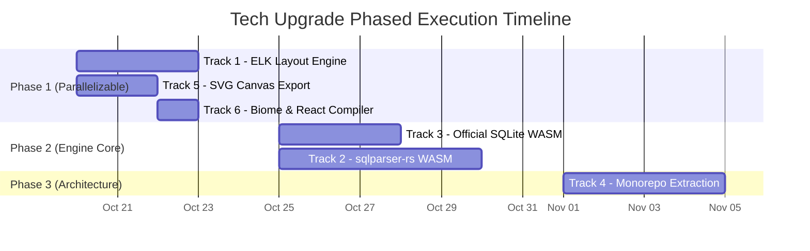
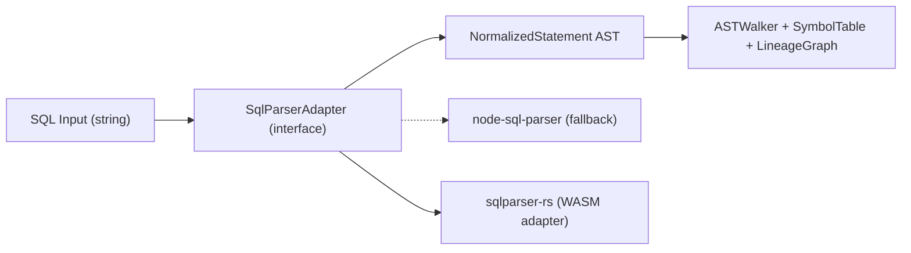
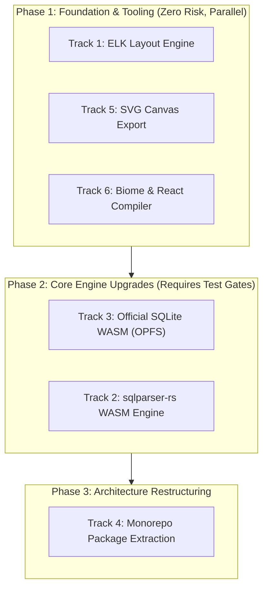

# ERD Forge — Tech Stack Upgrade Plan (Next Phase)

> **Document Type:** Architecture & Implementation Plan  
> **Status:** Approved / Ready for Execution  
> **Created:** 2026-10-13  
> **Scope:** Infrastructure, dependencies, and architecture modernization for enterprise scale and long-term production resilience  
> **Affects:** Graph layout engine, multi-dialect SQL parser, storage layer, export pipeline, monorepo architecture, and developer tooling

---

## 1. Executive Summary & Approved Decisions

ERD Forge's current tech stack is well-architected for its v1.0 release. However, several foundational dependencies are unmaintained, limited in syntax support, or bound tightly to DOM contexts. This upgrade plan establishes **6 independent, phased upgrade tracks** to modernize the foundation for 500+ table schemas, multi-dialect SQL lineage parsing, and headless tool consumption.

### Architectural Decisions

| Decision Topic | Selected Strategy | Rationale & Trade-off Summary |
|:---|:---|:---|
| **SQL Parser Engine** | **`sqlparser-rs` (WASM)** | Purpose-built for static multi-dialect AST parsing across BigQuery, Snowflake, T-SQL, PostgreSQL, and Databricks. Has a ~500 KB bundle size vs ~25 MB for DuckDB-WASM, boots instantly (<50 ms), and avoids strict COOP/COEP browser header constraints. |
| **Package Distribution** | **Workspace-Internal First (`private: true`)** | Keeps extracted packages (`@erd-forge/core`, `@erd-forge/parser-sdl`, `@erd-forge/lineage`) private within the pnpm workspace during rapid feature development. Avoids SemVer release drag; package structures are kept npm-ready to publish publicly when APIs stabilize. |
| **Developer Tooling** | **One-Shot Biome Cutover** | Replaces ESLint placeholders with a single `biome.json` in one shot. Because ESLint has no configured rule debt in the repo, a parallel transition is unnecessary and a clean cutover provides instant sub-second CI linting and formatting. |

---

## 2. Upgrade Tracks Overview

| Track | Name | Priority | Risk | Effort | Dependencies | Target Outcome |
|:-----:|:-----|:--------:|:----:|:------:|:-------------|:---------------|
| **1** | **Graph Layout Engine** (Dagre → ELK) | 🔴 High | Medium | ~3 days | None | Sub-thread layout, compound nodes for domains/sheets, 500+ table scalability |
| **2** | **SQL Parser** (node-sql-parser → sqlparser-rs WASM) | 🔴 High | High | ~5 days | None | Complete dialect support (`QUALIFY`, `PIVOT`, Snowflake/BigQuery/Databricks) |
| **3** | **SQLite Storage** (wa-sqlite → @sqlite.org/sqlite-wasm) | 🟡 Medium | High | ~3 days | None | True OPFS synchronous disk I/O, official consortium support, clean types |
| **4** | **Monorepo Package Extraction** | 🟡 Medium | Medium | ~4 days | Tracks 1–3 recommended first | Headless core, parser, and lineage packages with zero DOM dependencies |
| **5** | **Canvas Export** (html-to-image → SVG Serialization) | 🟢 Low | Low | ~2 days | None | Crash-free vector SVG/PNG export, no Safari canvas tainting |
| **6** | **Developer Tooling** (Biome + React Compiler) | 🟢 Low | Low | ~1 day | None | 20x faster lint/format in CI, automatic memoization on React 19 canvas nodes |



---

## 3. Detailed Track Specifications

---

### Track 1: Graph Layout Engine — Dagre → ELK

#### Problem Statement
`@dagrejs/dagre` is unmaintained, lacks compound node support (needed for visual domain and sheet grouping), has poor orthogonal edge routing on dense schemas, and cannot run off the main thread. ELK (Eclipse Layout Kernel via `elkjs`) is the industry standard for hierarchical graph layout (used by Mermaid, PlantUML, and enterprise graph visualizers).

#### Current Surface Area
* `apps/web/src/core/layout/autoLayout.ts` — ERD canvas layout (121 lines)
* `apps/web/src/lineage/layout/lineageLayout.ts` — Lineage canvas layout (91 lines)
* `apps/web/src/components/canvas/ERDCanvas.tsx` — Consumes layout positions
* `apps/web/tests/core/layout/autoLayout.test.ts` — Existing test suite (140 lines)

#### Changes Required

##### 1. Dependency Swap (`apps/web/package.json`)
```diff
 dependencies: {
-    "@dagrejs/dagre": "^3.1.1",
+    "elkjs": "^0.9.3",
     "@xyflow/react": "^12.11.6",
-    "@types/dagre": "^0.7.54",
```

##### 2. Implementation (`apps/web/src/core/layout/autoLayout.ts`)
The public contract (`LayoutTable`, `LayoutRef`, `LayoutOptions`, `LayoutMap`) remains identical. The function converts to `async` to support ELK's promise-based Web Worker execution.

```typescript
import ELK, { ElkNode } from 'elkjs/lib/elk.bundled.js';

const elk = new ELK();

export async function calculateAutoLayout(
  tables: LayoutTable[],
  refs: LayoutRef[],
  options: LayoutOptions = {}
): Promise<LayoutMap> {
  const {
    direction = 'LR',
    nodeWidth = 260,
    nodeSpacingY = 50,
    rankSpacing = 100,
  } = options;

  const elkGraph: ElkNode = {
    id: 'root',
    layoutOptions: {
      'elk.algorithm': 'layered',
      'elk.direction': direction === 'LR' ? 'RIGHT' : 'DOWN',
      'elk.spacing.nodeNode': String(nodeSpacingY),
      'elk.layered.spacing.baseValue': String(rankSpacing),
      'elk.padding': '[top=80,left=80,bottom=80,right=80]',
    },
    children: tables.map((table) => ({
      id: table.name,
      width: nodeWidth,
      height: estimateTableHeight(table.columns?.length ?? 0),
    })),
    edges: refs
      .filter((ref) => ref.sourceTable !== ref.targetTable)
      .map((ref, idx) => ({
        id: `edge-${idx}`,
        sources: [ref.direction === '<' ? ref.sourceTable : ref.targetTable],
        targets: [ref.direction === '<' ? ref.targetTable : ref.sourceTable],
      })),
  };

  const layout = await elk.layout(elkGraph);
  const positions: LayoutMap = new Map();

  layout.children?.forEach((child) => {
    positions.set(child.id, {
      x: Math.round(child.x ?? 80),
      y: Math.round(child.y ?? 80),
    });
  });

  // Fallback for unlinked tables
  tables.forEach((table) => {
    if (!positions.has(table.name)) {
      positions.set(table.name, { x: 80, y: 80 });
    }
  });

  return positions;
}
```

##### 3. Caller Updates (`ERDCanvas.tsx`)
```diff
-const autoPositions = calculateAutoLayout(tables, refs, { direction });
+const autoPositions = await calculateAutoLayout(tables, refs, { direction });
```

---

### Track 2: SQL Parser — node-sql-parser → sqlparser-rs (WASM)

#### Problem Statement
`node-sql-parser` suffers from dialect limitations: Databricks falls back to Hive, Oracle falls back to T-SQL, and it fails on modern clauses like `QUALIFY`, `PIVOT`, `UNPIVOT`, Snowflake `MATCH_RECOGNIZE`, and BigQuery procedural statements. `sqlparser-rs` is an active, standard Rust SQL parser compiled to WebAssembly supporting 15+ dialects.

#### Current Surface Area
* `apps/web/src/lineage/parser/sqlLineageParser.ts` — Core parser (688 lines)
* `apps/web/src/workers/lineage.worker.ts` — Web worker wrapper
* `apps/web/src/lineage/parser/ASTWalker.ts` — AST traversal utilities
* `apps/web/src/lineage/parser/SymbolTable.ts` — Scope resolution
* `apps/web/tests/lineage/sqlLineageParser.test.ts` — Test suite (272 lines)

#### Architecture: Adapter Pattern Migration

To eliminate regression risk, an adapter interface isolates AST generation from lineage extraction:



##### 1. Adapter Interface (`apps/web/src/lineage/parser/SqlParserAdapter.ts`)
```typescript
export interface NormalizedStatement {
  type: 'select' | 'insert' | 'create' | 'update' | 'delete' | 'merge';
  with?: NormalizedCTE[];
  from?: NormalizedFromItem[];
  columns?: NormalizedColumn[];
  where?: NormalizedExpr;
  groupBy?: NormalizedExpr[];
  orderBy?: NormalizedExpr[];
  having?: NormalizedExpr;
  qualify?: NormalizedExpr;
  _next?: NormalizedStatement;
  set_op?: string;
}

export interface SqlParserAdapter {
  readonly name: string;
  parse(sql: string, dialect: string): NormalizedStatement[];
}
```

##### 2. WASM Adapter Implementation (`apps/web/src/lineage/parser/WasmSqlParserAdapter.ts`)
```typescript
import init, { parse_sql } from 'sqlparser-wasm';

export class WasmSqlParserAdapter implements SqlParserAdapter {
  readonly name = 'sqlparser-rs';
  private initialized = false;

  async initialize(): Promise<void> {
    if (!this.initialized) {
      await init();
      this.initialized = true;
    }
  }

  parse(sql: string, dialect: string): NormalizedStatement[] {
    const rawAst = parse_sql(sql, dialect);
    return this.normalize(rawAst);
  }

  private normalize(rawAst: any[]): NormalizedStatement[] {
    // Normalization logic translating sqlparser-rs AST into NormalizedStatement
    return rawAst.map(/* ... */);
  }
}
```

##### 3. Parser Injection (`sqlLineageParser.ts`)
```diff
 export function parseSQLLineage(
   sql: string,
   dialect: SQLDialect = 'mssql',
-  options: ParseLineageOptions = {}
+  options: ParseLineageOptions = {},
+  adapter?: SqlParserAdapter
 ): ParseLineageResult
```

---

### Track 3: SQLite Storage — wa-sqlite → @sqlite.org/sqlite-wasm

#### Problem Statement
`apps/web/src/storage/OPFSSQLiteAdapter.ts` currently uses `@ts-ignore` hacks on internal wa-sqlite example files (`IDBBatchAtomicVFS.js`). It operates on IndexedDB rather than real Origin Private File System (OPFS). The official `@sqlite.org/sqlite-wasm` provides native TypeScript support, real OPFS synchronous access via `OpfsDb`, and backing by the SQLite consortium.

#### Current Surface Area
* `apps/web/src/storage/OPFSSQLiteAdapter.ts` — SQLite adapter
* `apps/web/src/storage/IndexedDBAdapter.ts` — Fallback adapter
* `apps/web/src/storage/StorageAdapter.ts` — Interface contract
* `apps/web/src/storage/index.ts` — Service initialization
* `apps/web/src/storage/migrations/MigrationRunner.ts` — DDL migration runner

#### Changes Required

##### 1. Dependency Swap (`apps/web/package.json`)
```diff
 dependencies: {
-    "wa-sqlite": "^1.0.0",
+    "@sqlite.org/sqlite-wasm": "^3.46.0",
```

##### 2. Implementation (`apps/web/src/storage/OPFSSQLiteAdapter.ts`)
```typescript
import sqlite3InitModule from '@sqlite.org/sqlite-wasm';
import { StorageAdapter } from './StorageAdapter';

export class OPFSSQLiteAdapter implements StorageAdapter {
  private db: any = null;
  private sqlite3: any = null;

  async initialize(): Promise<void> {
    this.sqlite3 = await sqlite3InitModule({
      print: console.log,
      printErr: console.error,
    });

    if (this.sqlite3.oo1.OpfsDb) {
      this.db = new this.sqlite3.oo1.OpfsDb('catalog.db');
      console.log('Using native OPFS SQLite');
    } else {
      this.db = new this.sqlite3.oo1.DB('catalog.db', 'ct');
      console.warn('OPFS unavailable, falling back to memory/transient SQLite');
    }
  }

  async query<T = any>(sql: string, params: any[] = []): Promise<T[]> {
    if (!this.db) throw new Error('DB not initialized');
    const results: T[] = [];
    this.db.exec({
      sql,
      bind: params.length > 0 ? params : undefined,
      rowMode: 'object',
      callback: (row: T) => { results.push(row); },
    });
    return results;
  }

  async execute(sql: string, params: any[] = []): Promise<void> {
    if (!this.db) throw new Error('DB not initialized');
    this.db.exec({
      sql,
      bind: params.length > 0 ? params : undefined,
    });
  }

  async close(): Promise<void> {
    if (this.db) {
      this.db.close();
      this.db = null;
    }
  }
}
```

##### 3. Data Migration Bridge
Before switching existing local databases, `StorageService` executes a one-time migration:
1. Detects legacy IndexedDB schema from wa-sqlite.
2. Dumps catalog tables and user schema definitions to JSON.
3. Inserts into the newly created OPFS SQLite instance.
4. Marks migration complete in `localStorage`.

---

### Track 4: Monorepo Package Extraction

#### Strategy
Extract reusable headless domains into the `packages/` workspace while retaining `"private": true`. No external publishing overhead during active development, while remaining immediately importable by web apps, workers, and future CLI tools.

#### Directory Architecture
```
Area51/
├── packages/
│   ├── core/                          # @erd-forge/core (private: true)
│   │   ├── src/
│   │   │   ├── models/                # RelationalModel, SDLTable, SDLRef, SDLColumn
│   │   │   ├── commands/              # Undo/Redo command manager
│   │   │   └── layout/               # autoLayout.ts (ELK adapter)
│   │   ├── package.json
│   │   └── tsconfig.json
│   │
│   ├── parser-sdl/                    # @erd-forge/parser-sdl (private: true)
│   │   ├── src/
│   │   │   ├── grammar.pegjs
│   │   │   ├── grammar.js
│   │   │   ├── SDLParser.ts
│   │   │   ├── SDLSerializer.ts
│   │   │   └── SDLValidator.ts
│   │   ├── package.json
│   │   └── tsconfig.json
│   │
│   └── lineage/                       # @erd-forge/lineage (private: true)
│       ├── src/
│       │   ├── parser/                # sqlLineageParser, ASTWalker, SymbolTable
│       │   ├── models/                # LineageGraph, LineageNode, LineageEdge
│       │   ├── graph/                 # PipelineStitcher, ERDLinker
│       │   └── layout/               # lineageLayout.ts (ELK)
│       ├── package.json
│       └── tsconfig.json
│
└── apps/
    └── web/                           # @erd-forge/web
        └── src/
            ├── components/            # React UI components
            ├── stores/                # Zustand stores (consuming @erd-forge/core)
            └── workers/               # Web Workers (consuming @erd-forge/lineage)
```

#### Extraction Rules
1. **Zero DOM references:** `packages/*` cannot import React, Zustand, `window`, `document`, or DOM APIs.
2. **Independent test suites:** Move domain-specific unit tests into `packages/*/tests/`.
3. **Workspace linkage:** Wire via pnpm workspace protocol:
```json
{
  "dependencies": {
    "@erd-forge/core": "workspace:*",
    "@erd-forge/parser-sdl": "workspace:*",
    "@erd-forge/lineage": "workspace:*"
  }
}
```

---

### Track 5: Canvas Export — html-to-image → SVG Serialization

#### Problem Statement
`html-to-image` uses `<foreignObject>` injection to capture DOM nodes into canvas raster layers. This causes canvas tainting in Safari, fails with web fonts, and runs out of memory on 100+ table schemas.

#### Changes Required

##### 1. Remove Dependency (`apps/web/package.json`)
```diff
 dependencies: {
-    "html-to-image": "^1.11.13",
```

##### 2. Implementation (`apps/web/src/lineage/utils/exportUtils.ts`)
Serialize React Flow's native SVG viewport directly:

```typescript
export const downloadImage = async (
  element: HTMLElement,
  format: 'png' | 'svg',
  filename: string
): Promise<void> => {
  const viewport = element.querySelector('.react-flow__viewport');
  if (!viewport) throw new Error('React Flow viewport element not found');

  const clone = viewport.cloneNode(true) as SVGElement;
  
  // Clean styles and inline computed metrics
  clone.setAttribute('xmlns', 'http://www.w3.org/2000/svg');

  if (format === 'svg') {
    const serialized = new XMLSerializer().serializeToString(clone);
    const blob = new Blob([serialized], { type: 'image/svg+xml;charset=utf-8' });
    downloadBlob(blob, `${filename}.svg`);
  } else {
    // Render SVG into OffscreenCanvas or Canvas element for PNG export
    const svgString = new XMLSerializer().serializeToString(clone);
    const svgBlob = new Blob([svgString], { type: 'image/svg+xml;charset=utf-8' });
    const URL = window.URL || window.webkitURL || window;
    const blobURL = URL.createObjectURL(svgBlob);
    
    const image = new Image();
    image.onload = () => {
      const canvas = document.createElement('canvas');
      canvas.width = image.naturalWidth || 1920;
      canvas.height = image.naturalHeight || 1080;
      const ctx = canvas.getContext('2d');
      ctx?.drawImage(image, 0, 0);
      canvas.toBlob((blob) => {
        if (blob) downloadBlob(blob, `${filename}.png`);
        URL.revokeObjectURL(blobURL);
      }, 'image/png');
    };
    image.src = blobURL;
  }
};
```

---

### Track 6: Developer Tooling Upgrades

#### 6A. One-Shot Biome Cutover

##### 1. Root Configuration (`biome.json`)
```json
{
  "$schema": "https://biomejs.dev/schemas/1.9.0/schema.json",
  "organizeImports": { "enabled": true },
  "linter": {
    "enabled": true,
    "rules": {
      "recommended": true,
      "correctness": {
        "noUnusedVariables": "warn",
        "useExhaustiveDependencies": "warn"
      },
      "suspicious": {
        "noExplicitAny": "off"
      }
    }
  },
  "formatter": {
    "indentStyle": "space",
    "indentWidth": 2,
    "lineWidth": 120
  },
  "files": {
    "ignore": ["node_modules", "dist", "*.js", "grammar.js"]
  }
}
```

##### 2. Script Updates (`package.json` & `apps/web/package.json`)
```diff
 // Root package.json
 "devDependencies": {
+    "@biomejs/biome": "^1.9.0",
     "turbo": "^2.0.0",
     "typescript": "^5.5.0"
 }
 "scripts": {
-    "lint": "turbo run lint",
+    "lint": "biome check .",
+    "format": "biome format --write ."
 }

 // apps/web/package.json
 "scripts": {
-    "lint": "eslint src/ --ext .ts,.tsx",
+    "lint": "biome check src/"
 }
```

#### 6B. React Compiler Integration
ERD Forge runs React 19. The React Compiler automatically memoizes canvas node updates (`TableNode.tsx`, `ERDCanvas.tsx`), eliminating manual `useMemo` overhead during drag interactions.

##### `apps/web/vite.config.ts`:
```diff
 import react from '@vitejs/plugin-react';

 export default defineConfig({
   plugins: [
-    react(),
+    react({
+      babel: {
+        plugins: [['babel-plugin-react-compiler', {}]],
+      },
+    }),
   ]
 });
```

---

## 4. Phased Execution Order



1. **Phase 1:** Layout, export, and tooling upgrades are independent, non-breaking, and unblock UI smoothness.
2. **Phase 2:** Database and parser upgrades operate under adapter patterns with existing test suites as regression gates.
3. **Phase 3:** Extract headless packages after engine code has settled, preventing refactor churn.

---

## 5. Verification & Testing Matrix

| Track | Test Command | Manual Verification Gate |
|:-----:|:-------------|:-------------------------|
| **1** | `pnpm --filter @erd-forge/web test autoLayout.test.ts` | Load 50+ table schema → click Auto-Arrange → verify zero overlapping nodes and preserved parent-left hierarchy. |
| **2** | `pnpm --filter @erd-forge/web test sqlLineageParser.test.ts` | Verify full 272-line lineage test pass rate + paste Snowflake `QUALIFY` and BigQuery `PIVOT` queries to confirm parsing. |
| **3** | `pnpm --filter @erd-forge/web test tests/stores/` | Verify `Using native OPFS SQLite` in Chrome console; test IndexedDB fallback in private browsing mode. |
| **4** | `pnpm build && pnpm typecheck` | Confirm zero broken imports across `@erd-forge/*` workspace packages; verify zero DOM imports in `packages/core`. |
| **5** | Manual visual check | Export 100-node schema as SVG → verify rendering in Figma without missing fonts or truncated edges. |
| **6** | `pnpm lint` | `biome check .` passes across 100% of files in <200 ms; verify canvas drag FPS remains ≥60 FPS. |

---

## 6. Risk Matrix & Mitigations

| Identified Risk | Likelihood | Impact | Built-in Mitigation |
|:---|:---:|:---:|:---|
| **WASM Parser Incompatibility** | Medium | High | Adapter pattern allows falling back to `node-sql-parser` per dialect while the WASM adapter stabilizes. |
| **OPFS Unavailable in Older Browsers** | Medium | Medium | Dual-adapter strategy falls back gracefully to in-memory/IndexedDB SQLite. |
| **User Data Loss During SQLite Migration** | Low | Critical | Export-first migration script dumps schema to JSON backup prior to OPFS VFS creation. |
| **Import Churn in Monorepo Extraction** | High | Low | TypeScript compiler (`tsc --noEmit`) validates 100% of import paths across all packages before merge. |
| **React Compiler Edge Cases** | Low | Low | Can disable optimization on specific complex nodes with the `'use no memo'` directive. |
