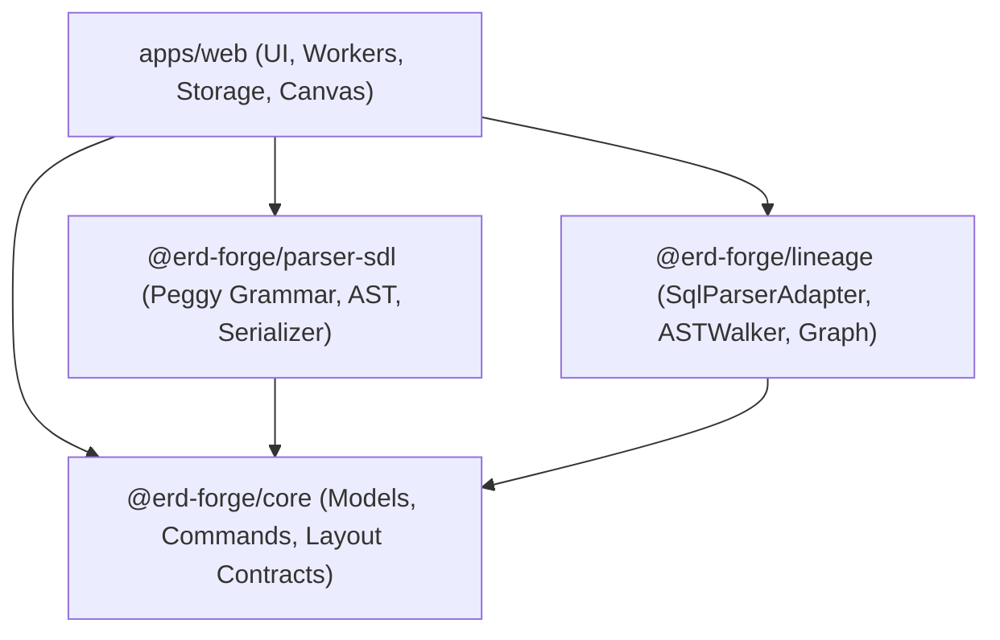

# Task Completion Report: T4.1 — Package Boundaries & Contracts

**Task ID:** T4.1  
**Milestone:** Phase 3: Monorepo Package Extraction (Gate 3)  
**Date:** October 23, 2026  
**Status:** Completed & Verified ✅  

---

## 1. Executive Summary

Task T4.1 establishes the package boundaries, dependency directions, and architectural contracts for decomposing ERD Forge into clean, modular, reusable packages within the pnpm/turbo monorepo.

To prevent circular dependencies and state leakage, the contracts enforce:
1. **Strict Zero-DOM Rule:** Core models, parsers, and lineage extractors are stripped of all browser globals (`window`, `document`, `HTMLElement`). TypeScript configuration targets `"lib": ["ES2022"]` without `"DOM"`.
2. **Strict Zero-React Rule:** State management (Zustand) and UI libraries are isolated entirely in `apps/web`. Extracted packages contain only pure data structures, algorithms, and AST walkers.
3. **Private Package Protection:** All packages specify `"private": true` to protect internal IP while enabling clean `workspace:*` linking.

---

## 2. Package Architecture & Contracts

### 2.1 Package Specifications

| Package Name | Location | Primary Responsibilities | Dependencies | Compiler Scope |
|:---|:---|:---|:---|:---|
| `@erd-forge/core` | `packages/core` | Domain entities (`Table`, `Column`, `Relationship`, `Project`, etc.), `CommandManager`, Undo/Redo commands | *None* | `ES2022`, Zero DOM, Zero React |
| `@erd-forge/parser-sdl` | `packages/parser-sdl` | Peggy grammar (`grammar.pegjs`), `SDLParser`, `SDLSerializer`, `SDLValidator` | `@erd-forge/core` | `ES2022`, Zero DOM, Zero React |
| `@erd-forge/lineage` | `packages/lineage` | `SqlParserAdapter`, `WasmSqlParserAdapter`, `ASTWalker`, `SymbolTable`, `PipelineStitcher`, `LineageGraph` | `@erd-forge/core`, `@guanmingchiu/sqlparser-ts`, `node-sql-parser` | `ES2022`, Zero DOM, Zero React |

---

## 3. Next Steps

- **T4.2 Extract Core & SDL Parser:** Move model classes, command patterns, layout interfaces, and peggy grammar into `packages/core` and `packages/parser-sdl`.
- **T4.3 Extract Lineage:** Move SQL normalizers, AST walkers, symbol tables, and lineage graph models into `packages/lineage`.
- **T4.4 Consumer Validation:** Wire workspace dependencies in `apps/web/package.json`, run `pnpm install`, and verify full build and tests.
